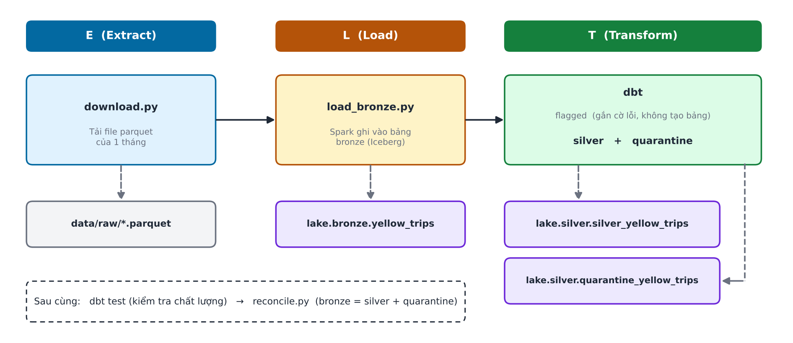
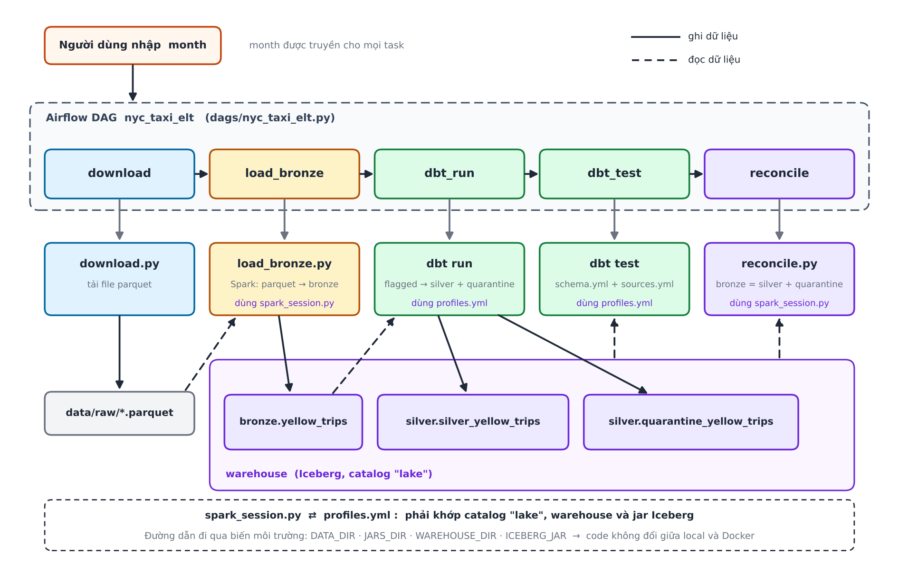

# NYC Taxi ELT – Data Lakehouse (Bronze → Silver)

Pipeline ELT chạy trên máy cá nhân: tải dữ liệu **NYC Yellow Taxi** của một tháng, nạp nguyên bản vào lớp **bronze**, sau đó làm sạch thành lớp **silver** trong data lakehouse (Apache Iceberg). Các dòng dữ liệu không hợp lễ sẽ không bị xóa mà được tách sang bảng **quarantine** kèm lý do không hợp lệ.

- **Input:** file parquet của 1 tháng (ví dụ `2024-06`, ~3,5 triệu dòng)
- **Output:** bảng `silver_yellow_trips` (dòng hợp lệ) và `quarantine_yellow_trips` (dòng lỗi) trong lakehouse
- **Điều phối:** Airflow, trigger thủ công và nhập tham số `month`

## Mục lục

1. [Kiến trúc và luồng ELT](#1-kiến-trúc-và-luồng-elt)
2. [Công nghệ sử dụng](#2-công-nghệ-sử-dụng)
3. [Cấu trúc thư mục](#3-cấu-trúc-thư-mục)
4. [Giải thích từng thành phần code](#4-giải-thích-từng-thành-phần-code)
5. [Các thành phần kết nối với nhau như thế nào](#5-các-thành-phần-kết-nối-với-nhau-như-thế-nào)
6. [Quy trình chạy của một lần trigger](#6-quy-trình-chạy-của-một-lần-trigger)
7. [Quy tắc làm sạch dữ liệu](#7-quy-tắc-làm-sạch-dữ-liệu)
8. [Cách chạy](#8-cách-chạy)
9. [Kết quả mẫu](#9-kết-quả-mẫu)
10. [Lưu ý và hạn chế](#10-lưu-ý-và-hạn-chế)
11. [Phân chia công việc giữa người làm và AI](#11-phân-chia-công-việc-giữa-người-làm-và-ai)

---

## 1. Kiến trúc và luồng ELT

Dữ liệu được nạp vào lakehouse trước, rồi mới biến đổi ngay trong lakehouse để thành model **silver**.


Luồng trong Airflow (DAG `nyc_taxi_elt`):

```
download ──▶ load_bronze ──▶ dbt_run ──▶ dbt_test ──▶ reconcile
```

## 2. Công nghệ sử dụng

| Công nghệ | Vai trò trong dự án |
|---|---|
| **Python + uv** | Viết code extract/load; `uv` quản lý môi trường ảo và khóa phiên bản (`uv.lock`) |
| **Apache Spark (PySpark 3.5.1)** | Đọc parquet và ghi vào bảng bronze Iceberg |
| **Apache Iceberg 1.5.2** | Định dạng bảng của lakehouse (catalog `lake`, kiểu Hadoop, lưu trong `warehouse/`) |
| **dbt (dbt-core + dbt-spark)** | Làm sạch dữ liệu: tạo silver và quarantine, chạy test chất lượng |
| **Apache Airflow 3.3** | Tự động hóa quy trình, nhập tham số `month` khi trigger |
| **Docker + Docker Compose** | Đóng gói toàn bộ (Java, Spark, jar Iceberg, dbt, Airflow, Postgres) |
| **PostgreSQL 16** | Chỉ là cơ sở dữ liệu metadata của Airflow, không chứa dữ liệu taxi |

Phiên bản **pyspark 3.5.1 phải khớp với jar `iceberg-spark-runtime-3.5_2.12-1.5.2`**. Đổi một bên thì phải đổi bên còn lại.

## 3. Cấu trúc thư mục

```
nyc_taxi_elt/
├── pyproject.toml                  # khai báo thư viện (uv)
├── uv.lock                         # khóa phiên bản thư viện
├── .python-version                 # Python 3.12
├── setup_project.sh                # script dựng cấu trúc project ban đầu
├── docker-compose.yml              # chạy Postgres + Airflow
├── .dockerignore                   # loại file thừa khỏi image
├── .gitignore
├── .env.example                    # mẫu biến môi trường
├── docker/
│   └── airflow/
│       ├── Dockerfile              # image: Airflow + Java + Spark + Iceberg + dbt
│       └── simple_auth_passwords.json   # mật khẩu đăng nhập Airflow
├── dags/
│   └── nyc_taxi_elt.py             # DAG Airflow (5 task)
├── src/nyc_elt/
│   ├── download.py                 # E: tải parquet
│   ├── spark_session.py            # tạo SparkSession có Iceberg (dùng chung)
│   ├── load_bronze.py              # L: ghi bronze
│   └── reconcile.py                # đối soát số dòng
├── dbt_project/
│   ├── dbt_project.yml             # cấu hình dbt, biến batch_month
│   ├── profiles.yml                # kết nối dbt ↔ Spark ↔ Iceberg
│   ├── macros/generate_schema_name.sql
│   └── models/
│       ├── sources.yml             # khai báo bảng bronze làm nguồn
│       └── silver/
│           ├── flagged_yellow_trips.sql      # gắn cờ lỗi (không tạo bảng)
│           ├── silver_yellow_trips.sql       # dòng hợp lệ
│           ├── quarantine_yellow_trips.sql   # dòng lỗi kèm lý do
│           └── schema.yml                    # test dbt
├── data/raw/                       # file parquet tải về (không commit)
├── jars/                           # jar Iceberg khi chạy local (không commit)
└── warehouse/                      # dữ liệu Iceberg khi chạy local (không commit)
```

Một số thư mục/file như `metastore_db/`, `derby.log`, `dbt_project/target/`, `dbt_project/logs/` được sinh ra khi chạy và đã nằm trong `.gitignore`.

## 4. Giải thích từng thành phần code

### 4.1 `src/nyc_elt/download.py` – Extract
- Nhận tham số `month` dạng `YYYY-MM`; sai định dạng thì báo lỗi ngay.
- Nếu file `data/raw/yellow_tripdata_<month>.parquet` đã có và đọc được thì **bỏ qua**; nếu hỏng thì tải lại.
- Tải về file tạm `.part`, kiểm tra đúng là parquet có dữ liệu rồi mới đổi tên. Nhờ vậy một lần tải dở không bị nhận nhầm là file hợp lệ.
- Thư mục dữ liệu lấy từ biến môi trường `DATA_DIR` (mặc định `./data`).

### 4.2 `src/nyc_elt/spark_session.py` – cấu hình Spark dùng chung
- Hàm `build_spark(app_name)` tạo SparkSession có **catalog Iceberg tên `lake`** (kiểu Hadoop) trỏ vào thư mục warehouse.
- Hàm `ensure_iceberg_jar()` tìm jar Iceberg trong `JARS_DIR`, chưa có thì tự tải về.
- Đặt `partitionOverwriteMode=dynamic` để ghi đè đúng phân vùng của từng tháng.
- File này được **`load_bronze.py` và `reconcile.py` cùng dùng**, nên cấu hình Spark chỉ viết ở một chỗ.

### 4.3 `src/nyc_elt/load_bronze.py` – Load vào bronze
1. Đọc file parquet của tháng bằng Spark.
2. Hàm `conform()` ép dữ liệu về **schema cố định 20 cột** (tên cột đưa về chữ thường, cột thiếu thành `NULL`, cột lạ bị bỏ kèm cảnh báo) và thêm 3 cột metadata: `source_month`, `_source_file`, `_ingested_at`. Schema cố định giúp các tháng khác nhau không bị lỗi lệch cột.
3. Tạo bảng `lake.bronze.yellow_trips` (Iceberg, phân vùng theo `source_month`) nếu chưa có.
4. Ghi bằng `overwritePartitions()`: chạy lại cùng một tháng chỉ ghi đè phân vùng tháng đó, **không bị trùng dữ liệu**.
5. Đối soát số dòng file với số dòng bronze; lệch thì báo lỗi.

### 4.4 dbt – Transform

| File | Vai trò |
|---|---|
| `dbt_project.yml` | Khai báo project `nyc_taxi`, biến **`batch_month`** (tháng cần xử lý), các model trong `silver/` ghi vào schema `silver`, định dạng Iceberg |
| `profiles.yml` | Cho dbt chạy Spark ở chế độ `session` với **cùng catalog `lake`, cùng warehouse, cùng jar** như `spark_session.py`; đọc đường dẫn từ biến `WAREHOUSE_DIR`, `ICEBERG_JAR` |
| `macros/generate_schema_name.sql` | Ghi đè cách đặt tên schema của dbt để bảng nằm đúng ở `silver` (không bị thành `silver_silver`) |
| `models/sources.yml` | Khai báo `bronze.yellow_trips` là nguồn; có test `source_month` không rỗng |
| `silver/flagged_yellow_trips.sql` | Model **ephemeral** (không tạo bảng): đọc bronze của tháng `batch_month`, tạo `trip_hash`, đánh số bản trùng, gắn cột `reject_reasons` |
| `silver/silver_yellow_trips.sql` | Lấy dòng có `reject_reasons` rỗng; `trip_hash` đổi tên thành `trip_id` |
| `silver/quarantine_yellow_trips.sql` | Lấy dòng có `reject_reasons` không rỗng |
| `silver/schema.yml` | Test dbt: `trip_id` unique và not null, các cột chính không rỗng |

Silver và quarantine đều dùng `incremental` + `insert_overwrite` theo `source_month`, nên chạy lại cùng tháng cũng không bị trùng.

### 4.5 `src/nyc_elt/reconcile.py` – đối soát
Đếm số dòng của tháng đó ở bronze, silver và quarantine, rồi kiểm tra **bronze = silver + quarantine**. Lệch hoặc bronze rỗng thì thoát với mã lỗi để Airflow đánh dấu task thất bại.

### 4.6 `dags/nyc_taxi_elt.py` – Airflow
- DAG `nyc_taxi_elt`, `schedule=None` (chỉ chạy khi trigger), `max_active_runs=1`, mỗi task thử lại 1 lần.
- Tham số `month` có kiểm tra dạng `YYYY-MM` ngay lúc trigger (mặc định `2024-06`).
- Mỗi task là một `BashOperator` gọi đúng lệnh bạn có thể chạy tay (xem mục 6).

### 4.7 Docker
- **`Dockerfile`**: nền `apache/airflow:3.3.0-python3.12`; cài Java 17 và uv; tải sẵn jar Iceberg vào `/opt/jars`; cài thư viện project vào **venv riêng `/opt/venv`** (tách khỏi Python của Airflow để tránh xung đột); copy `src/` và `dbt_project/` vào `/opt/project`; đặt các biến môi trường.
- **`docker-compose.yml`**: hai service `postgres` (metadata của Airflow) và `airflow` (chế độ `standalone`). Volume `warehouse` là **riêng của Docker**; `./dags` và `./data` gắn từ máy. Cả hai service có `restart: unless-stopped`.

## 5. Các thành phần kết nối với nhau như thế nào


| Điểm kết nối | Ai ghi | Ai đọc |
|---|---|---|
| **File parquet** `data/raw/yellow_tripdata_<month>.parquet` | `download.py` | `load_bronze.py` |
| **Bảng bronze** `lake.bronze.yellow_trips` | `load_bronze.py` | dbt (qua `sources.yml`), `reconcile.py` |
| **Bảng silver và quarantine** `lake.silver.*` | dbt | `dbt test`, `reconcile.py` |
| **Tham số `month`** | người dùng nhập khi trigger | tất cả các bước (`batch_month` trong dbt) |



Hai ràng buộc quan trọng khi sửa code:
1. **Cấu hình Iceberg nằm ở hai nơi**: `spark_session.py` (cho Python) và `profiles.yml` (cho dbt). Cả hai phải dùng **cùng tên catalog `lake`, cùng warehouse, cùng jar**. Đổi một nơi thì sửa nơi còn lại.
2. **Đường dẫn đi qua biến môi trường** (`DATA_DIR`, `JARS_DIR`, `WAREHOUSE_DIR`, `ICEBERG_JAR`). Chạy local dùng giá trị mặc định tương đối (`./data`, `./jars`, `./warehouse`); trong Docker, `Dockerfile` đặt sang `/opt/...`. Vì vậy **code không đổi** giữa hai môi trường.

## 6. Quy trình chạy của một lần trigger

Ví dụ trigger với `month = 2024-06`:

| Bước | Task | Lệnh thực tế | Kết quả |
|---|---|---|---|
| 1 | `download` | `python -m nyc_elt.download 2024-06` | Có file `data/raw/yellow_tripdata_2024-06.parquet` (bỏ qua nếu đã có) |
| 2 | `load_bronze` | `python -m nyc_elt.load_bronze 2024-06` | Phân vùng `source_month=2024-06` của bronze được ghi đè; số dòng bronze = số dòng file |
| 3 | `dbt_run` | `dbt run --vars '{"batch_month": "2024-06"}'` | `flagged` được nhúng vào hai model; silver và quarantine được ghi đè phân vùng `2024-06` |
| 4 | `dbt_test` | `dbt test ...` | 9 test chất lượng (unique, not null) phải đạt |
| 5 | `reconcile` | `python -m nyc_elt.reconcile 2024-06` | In `KHỚP: bronze = silver + quarantine`, nếu lệch thì task thất bại |

Một task thất bại thì các task sau không chạy. Mọi bước đều **idempotent**: chạy lại cùng tháng không tạo dữ liệu trùng.

## 7. Quy tắc làm sạch dữ liệu

Một dòng vi phạm bất kỳ quy tắc nào sẽ vào **quarantine** kèm danh sách lý do trong cột `reject_reasons` (một dòng có thể có nhiều lý do). Dòng không vi phạm nào thì vào **silver**.

| Lý do | Điều kiện |
|---|---|
| `missing_pickup_or_dropoff` | giờ đón hoặc giờ trả bị rỗng |
| `dropoff_before_pickup` | giờ trả không sau giờ đón |
| `trip_too_long` | thời lượng trên 24 giờ |
| `pickup_outside_month` | giờ đón không thuộc tháng đang xử lý |
| `negative_amount` | `fare_amount` hoặc `total_amount` âm |
| `invalid_distance` | `trip_distance` âm hoặc trên 100 dặm |
| `invalid_passenger_count` | số khách âm hoặc trên 6 (số khách bằng 0 hoặc rỗng vẫn hợp lệ) |
| `duplicate` | trùng một chuyến khác (giữ bản đầu tiên) |

Chuyến được xác định trùng bằng `trip_hash` (SHA-256 của hãng xe, giờ đón, giờ trả, điểm đón, điểm trả, quãng đường, tiền cước, tổng tiền). Các ngưỡng 24 giờ, 100 dặm, 6 khách là lựa chọn của dự án, có thể chỉnh trong `flagged_yellow_trips.sql`.

**Đối soát:** vì silver và quarantine cùng lấy từ một phép gắn cờ, mỗi dòng bronze vào đúng một trong hai bảng, nên luôn có `bronze = silver + quarantine`.

## 8. Cách chạy

### 8.1 Bằng Docker + Airflow (khuyên dùng)

Yêu cầu: Docker Desktop đang chạy (nên cấp ít nhất khoảng 6 GB RAM).

```bash
# từ thư mục gốc project
docker compose up -d --build     # lần đầu; các lần sau chỉ cần: docker compose up -d
```

1. Đợi 1 đến 2 phút, mở **http://localhost:8080**.
2. Đăng nhập: tài khoản **`admin`**, mật khẩu **`loc123`** (khai báo trong `docker/airflow/simple_auth_passwords.json`).
3. Vào DAG `nyc_taxi_elt`, bấm **Trigger**, nhập `month` (ví dụ `2024-06`).
4. Cả 5 task chuyển xanh là thành công. Task `reconcile` xanh nghĩa là số dòng đã khớp.

Chỉ cần `--build` khi sửa `src/`, `dbt_project/` hoặc `Dockerfile` (vì chúng được đóng vào image). Thư mục `dags/` được mount nên sửa xong chỉ cần đợi khoảng 30 giây.

Dừng/xóa:
```bash
docker compose stop        # dừng, giữ nguyên dữ liệu
docker compose down        # xóa container, vẫn giữ volume
docker compose down -v     # CẢNH BÁO: xóa luôn volume (mất bronze, silver trong Docker)
```

### 8.2 Chạy tay trên máy (không qua Docker)

Yêu cầu: **Python 3.12, uv, Java 17 hoặc 21**. Trên **Windows** cần thêm `winutils.exe` và `hadoop.dll` (Hadoop 3.3.x) và đặt `HADOOP_HOME` trỏ tới thư mục chứa `bin/`.

```bash
# Windows (Git Bash): đặt trong mỗi cửa sổ terminal mới
export HADOOP_HOME='D:\hadoop'
export PATH="/d/hadoop/bin:$PATH"

# từ thư mục gốc project
uv sync

uv run python -m nyc_elt.download 2024-06
uv run python -m nyc_elt.load_bronze 2024-06        # lần đầu tự tải jar Iceberg vào ./jars
uv run dbt run  --project-dir dbt_project --profiles-dir dbt_project --vars '{batch_month: "2024-06"}'
uv run dbt test --project-dir dbt_project --profiles-dir dbt_project --vars '{batch_month: "2024-06"}'
uv run python -m nyc_elt.reconcile 2024-06
```

Luôn chạy lệnh **từ thư mục gốc project**, vì các đường dẫn mặc định là tương đối.

Xem nhanh số liệu:
```bash
uv run python -c "from nyc_elt.spark_session import build_spark; s = build_spark('q'); s.sql('select (select count(*) from lake.bronze.yellow_trips) bronze, (select count(*) from lake.silver.silver_yellow_trips) silver, (select count(*) from lake.silver.quarantine_yellow_trips) quarantine').show(); s.stop()"
```
### 8.3 Xem dữ liệu silver bằng DBeaver (service `spark-thrift`)
 
**Vì sao cần service này?** Lakehouse chỉ là các file Parquet cùng metadata Iceberg. DBeaver không tự đọc được các file đó, nó chỉ gửi câu SQL qua JDBC đến một engine SQL. `spark-thrift` là engine đó: một Spark Thrift Server chạy trong container, nhận SQL ở cổng `10000`, đọc metadata Iceberg để biết bảng gồm những file Parquet nào, đọc dữ liệu rồi trả các dòng về cho DBeaver.
 
```
DBeaver --JDBC, cổng 10000--> Spark Thrift Server --> metadata Iceberg --> file Parquet
(hiển thị)                    (container spark-thrift)                     (volume warehouse)
```
 
`spark-thrift` dùng chung image `nyc-elt-airflow` và chung volume `warehouse` với service `airflow`, nên thấy đúng các bảng mà DAG vừa ghi. Nó cấu hình catalog `lake` giống hệt `build_spark()`.
 
**Khởi động**
 
```bash
docker compose up -d --build
docker compose logs spark-thrift --tail 30   # chờ thấy dòng "Starting ThriftBinaryCLIService"
```
 
Lưu ý: cần chạy DAG ít nhất một lần để các bảng tồn tại trước khi truy vấn.
 
**Kết nối trong DBeaver**
 
1. Database > New Database Connection > chọn **Apache Hive** (hoặc Apache Spark). DBeaver sẽ hỏi tải driver, chọn Download.
2. Host: `localhost`, Port: `10000`, Database: `default`.
3. Username: nhập tên bất kỳ (ví dụ `admin`), để trống Password.
4. Test Connection rồi Finish.
5. Mở SQL Editor và gõ **tên đầy đủ** của bảng:
```sql
select * from lake.silver.silver_yellow_trips limit 10;
 
select reject_reasons, count(*) as so_dong
from lake.silver.quarantine_yellow_trips
group by reject_reasons
order by so_dong desc;
```
 
Cây thư mục bên trái của DBeaver có thể không hiển thị bảng của catalog `lake`. Đó là bình thường; cứ gõ SQL trực tiếp.
 
**Xử lý lỗi thường gặp**
 
| Hiện tượng | Cách xử lý |
|---|---|
| Không kết nối được cổng 10000 | Xem `docker compose logs spark-thrift --tail 50`; container có thể còn đang khởi động hoặc bị thiếu RAM |
| `Table or view not found` | Chưa chạy DAG, hoặc quên ghi đủ tên `lake.silver.<bảng>` |
| Truy vấn rất chậm | Thêm `limit`; Thrift Server chạy `local[2]` và 1 GB bộ nhớ |
 
Cách thay thế không cần DBeaver: `docker compose exec` chạy Spark SQL, hoặc `python -m nyc_elt.query "<SQL>"` khi chạy tay (mục 8.2).
## 9. Kết quả mẫu

Tháng `2024-06`:

| Bảng | Số dòng |
|---|---|
| bronze | 3.539.193 |
| silver | 3.475.897 |
| quarantine | 63.296 |

3.475.897 + 63.296 = 3.539.193 (khớp). Tỷ lệ bị loại khoảng 1,8%.

Số dòng theo lý do (một dòng có thể có nhiều lý do, nên tổng lớn hơn 63.296):

| Lý do | Số dòng |
|---|---|
| `negative_amount` | 61.915 |
| `dropoff_before_pickup` | 1.140 |
| `invalid_distance` | 169 |
| `pickup_outside_month` | 51 |
| `trip_too_long` | 20 |
| `invalid_passenger_count` | 18 |

Chạy DAG trong Docker với tháng này mất khoảng 1 phút 23 giây (file parquet đã có sẵn nên bước `download` bỏ qua).


- **Warehouse của Docker và của chạy local là hai nơi riêng.** Metadata Iceberg lưu đường dẫn tuyệt đối, nên không dùng chung thư mục `warehouse/` giữa hai môi trường.
- **Airflow `standalone` và `SimpleAuthManager` chỉ dành cho môi trường dev.** Mật khẩu `loc123` nằm trong repo; chỉ phù hợp bản chạy trên máy cá nhân.
- **`negative_amount` chiếm gần như toàn bộ quarantine** (61.915 dòng). Nhiều khả năng đây là hoàn tiền hoặc điều chỉnh giá; chưa phân tích theo `payment_type` nên chưa kết luận được có nên loại hay không.
- Mỗi lần chạy xử lý **một tháng**. Muốn nhiều tháng thì trigger lần lượt từng tháng.
- Schema bronze cố định theo các cột đã biết (gồm `cbd_congestion_fee` có từ 2025). Nếu NYC thêm cột mới, code sẽ cảnh báo và bỏ qua cột đó cho đến khi thêm vào `BRONZE_COLUMNS`.
- Chưa có lớp gold, chưa chạy theo lịch.

## 10. Phân chia công việc giữa người làm và AI

Dự án được làm theo từng bước: người làm quyết định và kiểm chứng, AI (Claude) viết code và kiểm tra ban đầu.

| Hạng mục | Người làm | AI (Claude) |
|---|---|---|
| **Phạm vi và yêu cầu** | Đặt bài toán (1 tháng NYC taxi → silver trong lakehouse), chọn công nghệ, chọn hướng giữ Iceberg | Góp ý, chỉ ra điểm mâu thuẫn (ví dụ thứ tự Docker, bronze nằm ở đâu) |
| **Thiết kế luồng** | Chốt luồng ELT, cấu trúc thư mục, thứ tự thực hiện (src → dbt → Docker → Airflow), quyết định tách dòng lỗi sang bảng riêng | Đề xuất phương án|
| **Quy tắc làm sạch** | Duyệt danh sách 8 quy tắc và các ngưỡng, đề xuất danh sách quy tắc và ngưỡng ban đầu | Đánh giá các quy tắc
| **Viết code** | Lên cấu trúc các file, chép file vào project, đọc và hiểu từng bước | Viết `src/`, `dbt_project/`, `Dockerfile`, `docker-compose.yml`, DAG, `setup_project.sh` |
| **Kiểm tra** | Chạy trên máy thật: tải dữ liệu thật, Spark + Iceberg, dbt, Docker, Airflow; báo kết quả và lỗi | Kiểm tra bằng dữ liệu giả trong môi trường riêng (logic ép schema, quy tắc làm sạch, idempotent, test dbt, cú pháp DAG) |
| **Gỡ lỗi** | Chạy lệnh, gửi log và ảnh chụp lỗi; cài môi trường (Java, `winutils` trên Windows, Docker Desktop) | Đọc log, tìm nguyên nhân (ví dụ lỗi `winutils`, lỗi cache dbt trong image) và đưa cách sửa |
| **Đóng gói** | Build image, chạy DAG, sửa file README và đẩy lên GitHub | Viết `README.md`, `.gitignore`, `.dockerignore` |
